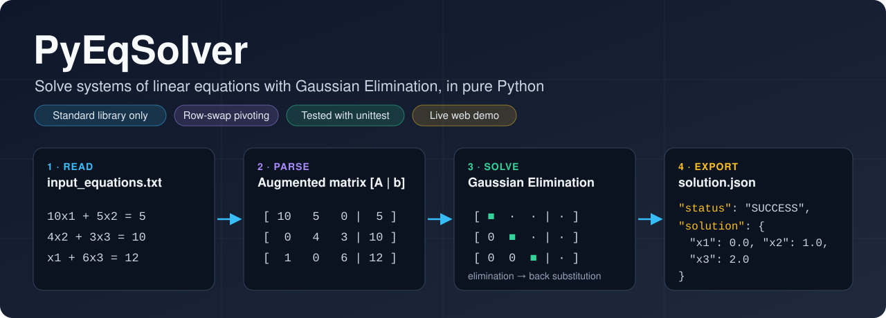

<p align="center">
  
</p>

# PyEqSolver

**Linear System Solver via Gaussian Elimination**, written in pure Python
(standard library only).

PyEqSolver reads a system of linear equations from a text file, turns it
into an augmented matrix `[A | b]`, solves it with Gaussian Elimination
written by hand on plain Python lists, and saves the result to a JSON file.
When the system cannot be solved, it does not crash: it explains why, in
the same JSON file.

```text
10x1 + 5x2 = 5          ->   x1 = 0.0
4x2 + 3x3 = 10          ->   x2 = 1.0
x1 + 6x3 = 12           ->   x3 = 2.0
```

**Live demo:** https://pyeqsolver-project.streamlit.app/

## Contents

1. [Two ways to use it](#two-ways-to-use-it)
2. [Use it on the web](#use-it-on-the-web)
3. [Use it on your computer](#use-it-on-your-computer)
4. [Input file format](#input-file-format)
5. [Output format](#output-format)
6. [How the solver works](#how-the-solver-works)
7. [How no-solution and infinite-solution systems are detected](#how-no-solution-and-infinite-solution-systems-are-detected)
8. [Errors and exceptions](#errors-and-exceptions)
9. [Architecture](#architecture)
10. [Tests](#tests)
11. [Sample input files](#sample-input-files)
12. [Design decisions](#design-decisions)
13. [Project layout](#project-layout)

---

## Two ways to use it

| Way | What you need | Best for |
|---|---|---|
| **On the web** | A browser | A quick try, no installation |
| **On your computer** | Python 3.10 or newer | Running the project, its sample files and the tests |

Both use the same code: the same parser, the same solver and the same JSON
exporter.

---

## Use it on the web

1. Open https://pyeqsolver-project.streamlit.app/
2. Type your equations in the text box, one per line.
3. Click **Solve**.

The page shows:

- the value of each variable, or the error type and message;
- the augmented matrix `[A | b]` that the parser built;
- the JSON output, exactly as `main.py` writes it to `data/solution.json`.

---

## Use it on your computer

### Requirements

- Python 3.10 or newer.
- No third-party packages. Nothing to install with `pip`.

### Run the program

From the project folder:

    py main.py

What happens:

1. It reads `data/input_equations.txt`.
2. It solves the system.
3. It writes the result to `data/solution.json` (the `data` folder is
   created if it is missing).
4. It prints one line, for example `Solved. Results written to data/solution.json`.

The program exits with status `0` on success and `1` on any error, so other
scripts can tell whether the run worked. In PowerShell you can check it with:

    echo $LASTEXITCODE

To solve your own system, edit `data/input_equations.txt` and run
`py main.py` again.

### Use it from your own code

The package can also be used directly:

```python
from pyeqsolver import EquationParser, GaussianSolver, JSONExporter
from pyeqsolver.exceptions import PyEqSolverError

exporter = JSONExporter(output_path="data/solution.json")

try:
    parser = EquationParser(file_path="data/input_equations.txt")
    matrix, variables = parser.parse()

    solver = GaussianSolver(matrix=matrix, variables=variables)
    solutions = solver.solve()   # {'x1': 0.0, 'x2': 1.0, 'x3': 2.0}

    exporter.save(solutions=solutions, metadata=solver.get_metadata())
except (PyEqSolverError, FileNotFoundError) as e:
    exporter.save_error(e)
```

> On macOS or Linux, use `python3` instead of `py` in every command.

---

## Input file format

One equation per line. Example (`data/input_equations.txt`):

    # Example 1: unique solution
    10x1 + 5x2 = 5
    4x2 + 3x3 = 10
    x1 + 6x3 = 12

The parser turns it into:

```python
variables = ['x1', 'x2', 'x3']

matrix = [[10.0, 5.0, 0.0,  5.0],
          [ 0.0, 4.0, 3.0, 10.0],
          [ 1.0, 0.0, 6.0, 12.0]]
```

Each row is one equation: the coefficients in variable order, then the
constant from the right-hand side.

### What is accepted

| Rule | Example |
|---|---|
| Variable names follow Python identifier rules: a letter or `_`, then letters, digits or `_` | `x`, `y`, `x1`, `price_2` |
| Variable order is the order of first appearance in the file | `y + x = 1` gives `['y', 'x']` |
| Integer or decimal coefficients, positive or negative | `3x`, `-2.5y`, `+ 0.75z` |
| A variable with no number has coefficient 1 or -1 | `x` means `1x`, `-x` means `-1x` |
| An optional `*` between number and variable | `3*x`, `2 * x` |
| Spaces around operators are optional | `2x+3y=5` is the same as `2x + 3y = 5` |
| A variable missing from a line gets coefficient `0` | `x1` is missing from line 2 above |
| A repeated variable in one line is added together | `2x + 3x = 10` gives coefficient `5` |
| Blank lines and lines starting with `#` are skipped | `# comment` |
| Variables only on the left of `=`, one number on the right | `2x + 3y = -4` |

### What is rejected

A line is rejected with `InvalidFileFormatException` when it has:

| Problem | Example |
|---|---|
| No `=` sign, or more than one | `2x + 3y 7`, `x + y = 2 = 2` |
| An empty side | `2x + 3y =` |
| A character that is not a digit, letter, `_`, `.`, `+`, `-`, `*`, `=` or a space (brackets included) | `2x + (3y) = 7`, `2x @ 3y = 5` |
| Two operators in a row | `2x + - 3y = 5` |
| A number with no variable on the left side | `2x + 5 = 9` |
| A variable or more than one number on the right side | `x + y = z` |
| A space inside one term (see [Design decisions](#design-decisions)) | `2 x + y = 3`, `x y = 3` |

The file is also rejected when it has no equations at all (empty, or only
comments and blank lines).

The error message names the **real line number** in the file and the line
text, for example:

    Invalid equation at line 3: '2x + 3y 7'. Expected exactly one '=' sign.

---

## Output format

Every run ends with one JSON file at `data/solution.json`.

**Success:**

```json
{
  "status": "SUCCESS",
  "system_info": {
    "num_variables": 3,
    "num_equations": 3
  },
  "solution": {
    "x1": 0.0,
    "x2": 1.0,
    "x3": 2.0
  }
}
```

**Error:** `error_type` is the exception's class name.

```json
{
  "status": "ERROR",
  "error_type": "InconsistentSystemException",
  "message": "The system has no solution (row reduces to 0 = 1)"
}
```

Rules:

- Written with `json.dump(..., indent=2)`.
- Every value is rounded to **4 decimal places** (`1/3` becomes `0.3333`).
- `-0.0` is written as `0.0`. Rounding a tiny negative number such as
  `-0.00001` gives `-0.0`, which looks wrong to users.

You can check a result by putting the values back into the equations:
`10(0) + 5(1) = 5`, `4(1) + 3(2) = 10`, `0 + 6(2) = 12`.

---

## How the solver works

The solver is Gaussian Elimination written by hand: no NumPy, no algebra
library. The matrix is a `list` of `list[float]`, and every row operation is
a loop. It works on a **copy** of the matrix, so the caller's data is never
changed.

**1. Forward elimination.** For each column, the solver picks a pivot row,
then subtracts a multiple of it from every row below, so the column becomes
zero under the pivot:

    factor = value under the pivot / pivot
    row    = row - factor * pivot row      (the constant too)

**2. Row swap (mandatory pivoting).** If the pivot is zero, the solver swaps
in a lower row that has a non-zero value in the same column. Without this,
the valid system below would divide by zero:

    x + y + z  = 6
    x + y + 2z = 9
    x + 2y + z = 8

After the first column is cleared, row 2 has `0` under `y`, so rows 2 and 3
are swapped. The answer is `x = 1, y = 2, z = 3`.

**3. Back substitution.** Starting from the last pivot row, each variable is
computed from the values already found, from the bottom up.

**Floating-point tolerance.** Any number with absolute value below `1e-9` is
treated as zero, because floats are not exact: `0.1 + 0.2 - 0.3` is not
exactly `0`.

---

## How no-solution and infinite-solution systems are detected

Before elimination, the solver checks that there are at least as many
equations as variables; if not, it raises `DimensionMismatchException`.
It then runs forward elimination and counts the pivots it found: this count
is the **rank** of the system. Every row below the last pivot has all its
coefficients equal to zero. If one of those rows still has a non-zero
constant, it reads `0 = c` with `c ≠ 0`, which is impossible, so the system
has **no solution** and the solver raises `InconsistentSystemException`.
If all those rows read `0 = 0` but the rank is smaller than the number of
variables, at least one variable is free, so the system has **infinitely
many solutions** and the solver raises `InfiniteSolutionsException`.
Otherwise the rank equals the number of variables and the solution is
unique. Extra equations that agree with the others (for example 3
equations for 2 variables) are allowed.

Two small examples:

| System | After elimination | Result |
|---|---|---|
| `x + y = 2` / `x + y = 3` | `[1 1 \| 2]`, `[0 0 \| 1]` → `0 = 1` | No solution |
| `x + y = 2` / `2x + 2y = 4` | `[1 1 \| 2]`, `[0 0 \| 0]` → rank 1 < 2 variables | Infinitely many solutions |

---

## Errors and exceptions

All project errors inherit from one base class, `PyEqSolverError`, so
`main.py` can catch every expected error with one `except` and still let
real bugs show up.

```text
Exception
└── PyEqSolverError
    ├── InvalidFileFormatException
    ├── DimensionMismatchException
    ├── InconsistentSystemException
    └── InfiniteSolutionsException
```

| Exception | Raised by | When | Example message |
|---|---|---|---|
| `InvalidFileFormatException` | Parser | A line breaks the input rules, or the file has no equations | `Invalid equation at line 1: '2x + 3y 7'. Expected exactly one '=' sign.` |
| `DimensionMismatchException` | Solver | Fewer equations than variables | `2 equations for 3 variables (x, y, z)` |
| `InconsistentSystemException` | Solver | The system has no solution | `The system has no solution (row reduces to 0 = 1)` |
| `InfiniteSolutionsException` | Solver | The system has infinitely many solutions | `Infinitely many solutions: rank 1 < 2 variables` |
| `FileNotFoundError` | Parser (Python's own) | The input file does not exist | `No such file or directory: 'data/input_equations.txt'` |

Checks run in this order: dimension, then no solution, then infinite
solutions. On any of these errors, `main.py` writes the error JSON and exits
with status `1`.

---

## Architecture

Parsing, solving and exporting are three separate classes, each with one
job. The solver never reads files, and the parser never does maths beyond
building the matrix.

```text
input_equations.txt
        │
        ▼
EquationParser.parse()   →  matrix [A | b] + variable names
        │
        ▼
GaussianSolver.solve()   →  {variable: value}
        │
        ▼
JSONExporter.save()      →  solution.json  (status: SUCCESS)

If the parser or solver raises an error:
main.py catches it  →  JSONExporter.save_error()  →  solution.json  (status: ERROR)
```

| Class | Public methods | Responsible for |
|---|---|---|
| `EquationParser` | `__init__(file_path)`, `parse()` | Reading the file, validating each line, variable order, building `[A \| b]` |
| `GaussianSolver` | `__init__(matrix, variables)`, `solve()`, `get_metadata()` | Copying the matrix, elimination, rank check, back substitution |
| `JSONExporter` | `__init__(output_path)`, `save(solutions, metadata)`, `save_error(exc)` | Rounding, `-0.0` clean-up, creating the output folder, writing JSON |

- Helper steps are private methods (their names start with `_`), such as
  `_parse_line`, `_forward_eliminate`, `_check_consistency` and
  `_back_substitute`.
- Every public method has type hints and a docstring.
- There is no `print()` inside the package. Only `main.py` talks to the user.

---

## Tests

Run all tests from the project folder:

    py -m unittest discover -s tests -v

Expected result: `Ran 33 tests ... OK`.

| File | What it tests |
|---|---|
| `tests/test_parser.py` | Building the matrix, variable order, decimals, repeated and missing variables, comments, spacing rules, line numbers and every format error |
| `tests/test_solver.py` | Unique solutions (including the row swap), the three system errors, that the input matrix is not changed, and `get_metadata()` |
| `tests/test_exporter.py` | Success and error JSON, rounding to 4 places, `-0.0` clean-up, creating the output folder |

Each test input is a separate file in `tests/data/`. The 13 required cases:

| # | Input (`/` separates lines) | Expected | Test file |
|---|---|---|---|
| 1 | `10x1 + 5x2 = 5` / `4x2 + 3x3 = 10` / `x1 + 6x3 = 12` | `x1 = 0, x2 = 1, x3 = 2` | `case01.txt` |
| 2 | `x + y + z = 6` / `x + y + 2z = 9` / `x + 2y + z = 8` | `x = 1, y = 2, z = 3` (row swap) | `case02.txt` |
| 3 | `0.5a + 1.5b = 3.5` / `2a - b = 0` | `a = 1, b = 2` | `case03.txt` |
| 4 | `3x = 1` | `x = 0.3333` | `case04.txt` |
| 5 | `2x + 3x = 10` | `x = 2` (repeated variable) | `case05.txt` |
| 6 | `x + y = 3` / `x - y = 1` / `2x + 2y = 6` | `x = 2, y = 1` (extra equation) | `case06.txt` |
| 7 | `x + y = 2` / `x + y = 3` | `InconsistentSystemException` | `case07.txt` |
| 8 | `x + y = 2` / `2x + 2y = 4` | `InfiniteSolutionsException` | `case08.txt` |
| 9 | `x + y + z = 1` / `x - y = 0` | `DimensionMismatchException` | `case09.txt` |
| 10 | `2x + 3y 7` | `InvalidFileFormatException` (line 1) | `case10.txt` |
| 11 | `2x + (3y) = 7` | `InvalidFileFormatException` (brackets) | `case11.txt` |
| 12 | An empty file, or only comments | `InvalidFileFormatException` | `case12_empty.txt`, `case12_comments.txt` |
| 13 | A path that does not exist | `FileNotFoundError` | (no file) |

Solver tests compare floats with `assertAlmostEqual`, never `assertEqual`,
because floating-point results are not exact.

---

## Sample input files

The `data/` folder has one success case and one case for each error type:

| File | Result |
|---|---|
| `data/sample_success.txt` | `x = 5, y = 3, z = -2` |
| `data/sample_invalid_format.txt` | `InvalidFileFormatException` |
| `data/sample_dimension_mismatch.txt` | `DimensionMismatchException` |
| `data/sample_no_solution.txt` | `InconsistentSystemException` |
| `data/sample_infinite_solutions.txt` | `InfiniteSolutionsException` |

**On your computer:** copy a sample over the input file and run the program.

    Copy-Item data\sample_no_solution.txt data\input_equations.txt
    py main.py

**On the web:** paste the sample's lines into the text box and click **Solve**.

---

## Design decisions

- **Spaces inside a term are rejected.** Spaces around operators are
  allowed (`2x + 3y`, `- x`, `2 * x`), but a space inside one term is not
  (`2 x`, `x y`, `0.75 z`). Removing that space would silently join two
  terms: `x y` would become one variable called `xy`, which is guessing.
- **Real line numbers.** Error messages count every line in the file,
  including blank lines and comments, so the number matches what you see
  in your editor.
- **Files saved with a BOM.** The input file is read with `utf-8-sig`, so a
  file saved by Notepad with a byte order mark still parses correctly.
- **The solver copies the matrix** with `[row[:] for row in matrix]`.
  A plain `matrix[:]` would copy only the outer list, and row operations
  would still change the caller's rows.
- **Narrow `except`.** `main.py` catches only `PyEqSolverError` and
  `FileNotFoundError`, never a bare `except Exception`, so real bugs are not
  hidden.

---

## About the web demo

`app.py` is the Streamlit page behind the live demo. It is for
demonstration only: it calls the same `EquationParser`, `GaussianSolver`
and `JSONExporter`, and it is not used by `main.py` or the tests. The core
project itself uses the Python standard library only, and needs no
`pip install`.

---

## Project layout

    pyeqsolver-project/
    ├── pyeqsolver/
    │   ├── __init__.py          exports EquationParser, GaussianSolver, JSONExporter
    │   ├── exceptions.py        PyEqSolverError and its 4 subclasses
    │   ├── parser.py            EquationParser
    │   ├── solver.py            GaussianSolver
    │   └── exporter.py          JSONExporter
    ├── tests/
    │   ├── data/                one input file per test case
    │   ├── test_parser.py
    │   ├── test_solver.py
    │   └── test_exporter.py
    ├── data/
    │   ├── input_equations.txt  input read by main.py
    │   └── sample_*.txt         one success case and one per error type
    ├── assets/
    │   └── banner.svg           README banner
    ├── main.py                  command-line entry point
    ├── app.py                   optional Streamlit demo
    └── README.md